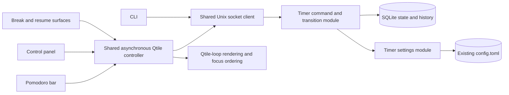
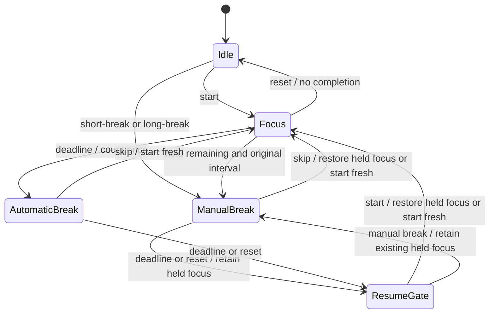

# Architecture: Manual Breaks and Timer Control Panel

## System Overview

Parent: [approved PRD](prd.md). This is a design proposal, not implementation
approval. Keep one authoritative Timer Service, its SQLite store and existing
CLI. The panel owns only display state and unsaved field text.

### Domain terms

**Manual Break**: a short/long break explicitly requested without completing a
focus session or changing cycle progress.

**Held Focus**: unfinished focus whose remaining time and original interval are
frozen during a manual break and its subsequent Resume Gate. It is distinct
from machine suspend and from pausing the currently displayed break.

**Original Focus Interval**: the configured focus duration captured when that
focus starts; later settings changes cannot alter its history accounting.

These terms extend the existing domain glossary when implementation is approved;
the proposal does not silently redefine Completed Focus Session or Resume Gate.

## Interface Alternatives Considered

1. **Minimal command facade:** `Timer.command(name, settings=None)` and
   `Timer.status()`. A caller submits `short-break` or `save-settings`; the
   module hides transitions, held focus, transactions and configuration writes.
   This preserves the existing CLI/socket shape with a small interface, but
   requires centralized command/state validation rather than static exhaustiveness.
2. **Typed phase/operation union:** `Timer.execute(BeginBreak('short'), now=...)`
   with separate Focusing/Breaking/ResumeGate dataclasses and command/result
   variants. This excludes more impossible states structurally, but introduces
   many classes, codecs, identities and a wholesale state rewrite for a small
   fixed command set. Reject that additional public surface for this feature.
3. **UI-first shared controller:** `controller.submit('pause')` and
   `controller.save_settings(values)` give bar/panel/overlays one snapshot and
   asynchronous dispatch. This hides scheduling and late-callback handling,
   but must not become a second timer or own persisted state.

**Selected:** alternative 1 inside the daemon, plus the asynchronous presentation
seam from alternative 3. Do not add an extensible command framework, event
sourcing, or a second authoritative state model.

## Technical Decisions (ADRs)

### ADR-010: Extend the existing state with one held-focus checkpoint

**Status:** Proposed.

Retain `phase`, `status`, `end_at`, `remaining`, and `completed_in_cycle`; add:

- `schema_version: 2` to the persisted JSON state payload;
- `focus_original_seconds: int | null` for an active/paused unfinished focus;
- `held_focus: {remaining_seconds: float, original_seconds: int} | null` while
  that unfinished focus is held by a break or Resume Gate.

Capture the original interval when a fresh focus actually starts. Preserve
fractional seconds internally when pausing/holding; round only the public
countdown so existing status consumers still receive integer `remaining`.
Only a running phase owns `end_at`. A held focus has no deadline. Active focus
metadata and held-focus metadata are never simultaneously owned. Idle and a
fresh-focus gate contain neither. A break's `remaining` belongs to the break,
not to its held focus.

Pause/resume operate on the current phase without changing ownership. Reject a
new manual-break command during either a running or paused break. From a paused
focus, capture its frozen remaining time without first starting it. From a gate
that already holds focus, another manual break preserves the same checkpoint.

Use one captured wall-clock value per transition. Before a valid timer action,
settle at most one expired phase, then validate the requested action against the
resulting state. Thus focus completion wins at its deadline: count it and start
its automatic break; a simultaneous manual-break request is then invalid.
Fresh phases read current settings, including the long-break threshold; held or
paused intervals retain their own snapshots. Cycle count is never reset by a
manual break or settings save.

### ADR-011: Commit state and focus completion together

**Status:** Proposed.

Replace separate history/state commits with a deep Store interface:
`commit(state, completed_focus_seconds=None)`. One SQLite transaction inserts a
completion, increments/persists the new state, and commits. Publish the new
in-memory state and completion notification only after persistence succeeds.
Persistence failure retains the prior in-memory state. No notification
exactly-once guarantee across process death is invented.

Keep the existing sessions table and history rows; no new focus-ID/history-index
migration is needed because one owner and an atomic state/history commit define
completion identity. Status reconciliation and the ticker use the same transition
path, preserving lazy expiry even if the ticker is unavailable.

On daemon replacement, an overdue focus completes once and starts one fresh
automatic break at recovery time. An overdue manual break enters its Resume Gate
with held focus intact, never an automatically running focus. A non-expired
phase keeps its deadline. Upgrade legacy state in the same transaction without
rewriting old history. Legacy payloads cannot reveal an original duration after
unrecorded historical config edits: initialize that missing snapshot from the
configuration loaded at upgrade and document this migration assumption; do not
claim to reconstruct unavailable history. New/resumed captured focus intervals
retain their original duration thereafter.

Acquire a per-user runtime advisory lock before constructing Timer or touching
SQLite, retaining the existing live-socket check for older daemons. Hold the
lock for the daemon lifetime. A duplicate launch must exit before recovery or
state migration can write anything. This closes the current startup order in
which Timer is constructed before duplicate-service refusal.

### ADR-012: Lossless settings editing with TOMLKit

**Status:** Proposed. Adds one non-GUI runtime dependency: `tomlkit`.

Use a focused `settings.py` module for the four owned timer keys, validation,
loading and document-preserving saves. Retain `tomllib` as a standards parser;
use TOMLKit to read/modify/write the existing document rather than invent a TOML
stanza parser or reconstruct arbitrary unrelated sections.

Validate the complete four-key input first: positive integers only, excluding
booleans and partial/unknown settings payloads. Invalid input returns an error
before expiry settlement or any file/state write. A valid save settles an
already-expired phase using the previously applied settings, then changes
future-phase defaults; it never retimes the phase that just became active.

Read the file afresh, replace only the four `[timer]` values and validate the
rendered result. Write a same-directory temporary file, flush and `fsync` its
contents, atomically replace the destination, then `fsync` the containing
directory before reporting a durable save. Synchronize newly created directory
entries when creating an absent config directory. Preserve existing permissions;
a new config uses owner-only permissions. Invalid TOML or a pre-replacement
error leaves the original file unchanged. Unknown sections, comments and
Todoist values remain in the document and are never returned to the panel.
Translate parser/writer errors into field or file-location messages without
echoing TOML source text or secret values, including malformed-token cases.

Filesystem replacement and SQLite are not one global transaction. Distinguish:

- `applied`: file replacement is durable and future defaults were applied;
- `saved_not_applied`: durable replacement succeeded but daemon application failed;
- `rejected`: validation or pre-replacement persistence failed;
- `unknown`: the reply was lost, or post-replacement synchronization failed and
  the visible replacement is not known durable. Never classify this as rejected
  or claim the original file is unchanged; retain previously applied runtime
  defaults, report the uncertainty, and do not blindly roll back or resubmit.
  Read-only refresh alone cannot upgrade uncertain durability to a successful
  persistent save; a later explicit successful Save establishes it.

Keep saved/applied timer settings and the latest application outcome in the
service snapshot; no full TOML or token is exposed. Reload retries application
of the saved document. A lost mutation reply triggers a read-only refresh,
not automatic resubmission. No external-editor file watcher or optimistic
revision/conflict system is added; fresh reads preserve unrelated edits made
before Save. The daemon remains the supported settings writer.

Documentation supports TOMLKit's style-preserving behavior; application-specific
round-trip/failure cases still require implementation tests. See the linked
[research memo](research/2026-10-15-toml-settings.md).

### ADR-013: One asynchronous transport and UI controller

**Status:** Proposed.

Extract the existing asyncio Unix-socket request implementation into `client.py`,
shared by CLI and Qtile. Use one bounded connection/write/read operation per
request, with connection closure in `finally`. Remove the widget's blocking
per-second `subprocess.check_output` status path; do not put popup drawing in a
worker thread or introduce a second protocol.

One controller per Qtile instance supplies cached service snapshots to all
Pomodoro bars, the control panel and break/resume surfaces. Poll at the existing
one-second cadence with at most one request in flight. User actions precede the
next poll; a successful action returns its complete snapshot. Disable repeated
submissions while a mutation is in flight rather than queueing duplicate clicks.
The service still validates every action, including requests from a stale panel.

Snapshots include the existing public timer fields, held-focus summary,
timer-only saved/applied settings, available commands and protocol version 2.
A stale daemon lacking the new protocol is an explicit upgrade-required error,
not a successful manual-break no-op. Preserve existing CLI commands; add
`short-break`, `long-break`, and `save-settings` with four explicit setting flags.
Keep the existing `ok/result/error` envelope and add machine-readable error codes.

On transport failure, keep the last snapshot marked stale, disable state-changing
panel actions, and leave closing available. Cancel poll/request tasks when the
last owning widget finalizes; discard callbacks after panel closure. Closing a
panel cannot undo a request already accepted by the service. Centralize existing
self-heal into one guarded asynchronous launch on absent/refused socket only;
do not spawn a second daemon merely because a request timed out or the protocol
is stale. No automatic retry of uncertain mutations.

### ADR-014: Explicit panel access during breaks; one focus owner

**Status:** Proposed.

`timer_panel.py` contains the native Popup and numeric-field draft/edit handling.
Use the existing dedicated-layout pattern, one geometry source for draw/hit
regions, Tab/Shift-Tab navigation, numeric input/Backspace in fields, Enter on
buttons and Escape to close. Unsaved drafts survive status refreshes but are
not persisted on close; clean fields follow service settings. Save errors keep
the draft visible. No extra GUI toolkit or task-overlay changes.

Bar click toggles the panel during normal focus/idle use. Add an explicit
**Controls** action to break and Resume Gate surfaces so settings, pause and
reset remain reachable when the full-screen overlay covers the bar. Only an
explicit Controls request may place a current panel above that overlay. This
is not a stale panel obscuring the break: its live state/controls remain owned
by the same controller and the break continues according to service state.

The shared UI controller owns stacking/focus and workspace hooks: render/raise
all active break surfaces, then the intentionally opened panel on the current
screen, then focus that foreground surface. Retain explicit X11
`StackMode.Above`, not ineffective Internal `place(above=True)` alone. Close the
panel on workspace switch and on transitions between focus, break and Resume
Gate; reassert the authoritative overlay immediately. Pause/resume within the
same break does not close a deliberately opened panel. Other screens stay
covered. Finalization unsubscribes hooks and disposes every popup/layout;
there is no independent panel timer or orphan controller.

Subscribe to Qtile 0.37 `screens_reconfigured` (after `_process_screens`), not
only the pre-change `screen_change` hook. Close the panel and reconcile popup
ownership against the new screen identities/geometries immediately from the
cached snapshot: dispose layouts/windows for removed or changed screens, create
correctly sized replacements/additions, then restore stacking/current-screen
focus. Do not leave excess old popups in a list or wait for the next status poll.
On `current_screen_change`, close the panel and coalesce a main-loop restack
after Qtile finishes its own screen-focus/layout work. Suppress that deferred
callback after finalization and unsubscribe all three lifecycle/workspace hooks.
An active controller's reconfiguration cannot change service timer state.

## Module and Cutover Plan

- `core.py`: extended state codec, centralized transitions, transactional Store,
  service dispatch and single-writer lifecycle.
- `settings.py` (new): typed four-field settings, validation and lossless save;
  move existing config-loading ownership and migrate its actual callers without
  retaining deprecated re-export aliases.
- `client.py` (new): one asynchronous socket client shared by CLI/controller.
- `cli.py`: retain current command meanings, add the three commands/payload flags.
- `qtile.py`: shared async controller, cached bar rendering, coordinated overlays
  and control-panel entry points; remove obsolete synchronous polling/transport.
- `timer_panel.py` (new): display/draft input and action callbacks only.
- `pyproject.toml`/lock: declare TOMLKit; task modules remain behaviorally unchanged.

Deploy the package into Qtile's interpreter and replace both the surviving
Timer Service and Qtile's module cache. Preserve persisted state; never use
reset/start or edit timer history as deployment steps. Unsupported newer state
versions fail clearly rather than being treated as legacy/default state.

## Verification Strategy

- Real temporary SQLite tests: held-focus capture from running/paused/gated
  states, fractional remaining preservation, original-duration accounting,
  reset/skip, invalid repeated manual breaks, deadline precedence, one-step
  recovery and atomic rollback without duplicate completions.
- Settings tests: all positive-int/error cases, absent config, unrelated sections
  and token preservation, valid quoted/dotted/multiline TOML, comments, permissions,
  failed replacement, saved-not-applied and unknown response handling; active,
  paused and held intervals remain unchanged while future phases use saved values.
- Protocol/controller tests: actual local socket commands, old protocol refusal,
  timeouts without duplicate mutations/spawns, one in-flight request, closed-panel
  callbacks and complete finalization. Exercise behaviors, not forwarding echoes.
- Actual Qtile smoke in an isolated timer environment: panel buttons/fields/Save,
  focus-to-manual-break-to-held gate, Controls while a break is active, workspace
  changes with occupied clients, multiple-screen ordering where available, and
  keyboard focus. Do not reset or shorten the user's active session. Record any
  unavailable multi-monitor surface instead of claiming it was exercised.

## Risks and Approval Gate

- Legacy original duration is not reconstructable after historical unrecorded
  config edits; the documented migration assumption applies only to that old
  snapshot, not future held-focus accounting.
- Configuration replacement and daemon application have distinct outcomes;
  explicit status avoids false success. Uncooperative concurrent external file
  writers are not promised a cross-process transaction.
- UI focus is shared between a full-screen overlay and an explicit modal panel;
  verify after the Qtile loop presents the surface, not from mapped flags alone.
- TOMLKit is a new runtime dependency, not an already-verified installation or
  application-specific preservation guarantee.

The user approved this architecture. Epic and story approval gates still apply.
Implementation, package installation, timer operations and configuration writes
are not granted by architecture approval or the separate metadata migration.

## Pre-Approval Design Review

Read-only core and UI reviewers examined this proposal against the approved PRD.
Both slices passed focused round-2 re-review; subsequent user architecture approval
is recorded in frontmatter. No implementation, runtime or library-preservation test was run.

| Finding | Resolution | Re-review |
|---|---|---|
| ARCH-CORE-001: durable settings save/outcome gap | ADR-012 now synchronizes temporary file and directory entries; post-replacement uncertainty is never called rejection or durable success. | ManualBreakCoreArchitectureReview: resolved, ready. |
| ARCH-UI-001: live screen-reconfiguration resource gap | ADR-014 reconciles removed/changed/added screens after reconfiguration, disposes resources, and defers current-screen restacking until Qtile completes its own focus work. | TimerPanelArchitectureReview: resolved, ready. |
